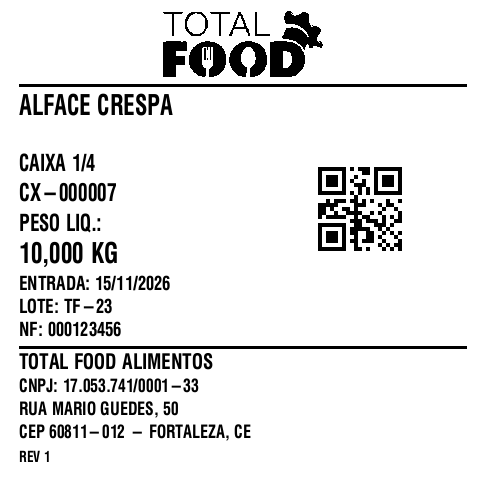

# Caixas de hortifruti + fila manual de impressão (ESP32-S3/Zebra ZD220)

## Escopo

- O recebimento em **/crates** aproveita o SKU existente de unidade base KG, o movimento ENTRADA, os lotes do WMS e os depósitos; não cria estoque paralelo.
- Cada caixa recebe um ID imutável `CX-000001` e uma posição X/Y no recebimento. Peso líquido inicial e atual são armazenados com três casas decimais.
- NF e fornecedor são vinculados ao movimento. O lote interno é o ID original de `stock_lots`; o lote de origem informado pelo vendedor é armazenado separadamente e pode ficar ausente. O ID interno não prova por si só a rastreabilidade de origem.
- A tela **/crates** lê o QR Code via câmera usando o scanner já disponível no WMS (com fallback manual).
- A pesagem de retorno com peso inferior realiza SAÍDA vinculada ao lote **específico** da caixa. Aumento de peso exige nova entrada/correção auditável, não está permitido no fluxo de retorno. Pesagem que zera a caixa registra a saída e marca a caixa como vazia, mas **não** gera etiqueta nova; a etiqueta que ainda estava na fila é cancelada ("Caixa vazia").
- A transferência da caixa realiza TRANSFERÊNCIA real entre depósitos, conserva o ID e o lote de recebimento, porém aponta a caixa para um lote de estoque no depósito de destino. O consumo posterior considera esse lote.
- Saídas e transferências genéricas não podem alocar um lote atualmente associado a caixas rastreadas; use a operação individual.
- A fila de impressão é persistente no Postgres; nenhuma chamada automática sai do ESP para o Render. Trabalhos antigos ainda pendentes são cancelados ao gerar nova revisão.

## Pareamento (uma vez)

1. No WMS, com permissão de administração de depósitos, acesse **Administração → Impressoras de etiquetas**, informe nome e copie o token exibido **uma única vez**.
2. No ESP, acesse `http://etiqueta.local/config` como administrador e informe URL HTTPS pública do WMS e token. Salve.
3. No WMS, receba caixas informando pesos individualizados. A entrada gera automaticamente jobs e as etiquetas 60×60 mm.
4. No ESP, abra a aba **Fila TotalFood** (`http://etiqueta.local/fila`) e toque **Buscar e imprimir etiquetas**. A busca acontece **apenas ao tocar**. A aba é separada da impressão manual para ninguém buscar a fila sem querer.
5. Confira fila e status no WMS. Em caso de falta de ACK ou reinício, não há reimpressão automática: o trabalho fica incerto e requer decisão do operador.

Para testar a impressora sem mexer no estoque, use **Enviar teste** na mesma seção: entra na fila uma etiqueta "ETIQUETA DE TESTE" só para aquela impressora (`POST /api/print/devices/{id}/test`, admin de depósitos). Depois toque em **Buscar e imprimir etiquetas** na aba **Fila TotalFood** do ESP32; a lista mostra a situação do último teste (aguardando, enviado ao USB, sem confirmação). Enquanto um teste daquela impressora não terminar, outro é recusado. No banco, a etiqueta de teste é o trabalho sem caixa (`crate_id` nulo) e sempre tem impressora definida (migration 040).

Na mesma seção ficam a lista de impressoras e o botão **Revogar** (pede um segundo toque). Uma impressora revogada perde o acesso na hora; o nome continua reservado, então um novo acesso precisa de outro nome. A fila de impressão continua na tela de Caixas, que é de operação.

O token é específico de dispositivo, armazenado como hash no servidor e não volta nas consultas de configuração do ESP. O ESP grava o segredo local em Preferences/NVS (proteja acesso físico e admin da rede local).

## API

| Ação | Método e rota | Proteção |
|---|---|---|
| Entrada identificada | `POST /api/crates/receive` | sessão, CSRF, movimento entrada |
| Consulta caixa | `GET /api/crates/{id}` | sessão, estoque leitura |
| Caixas ativas | `GET /api/crates?warehouse_id=&item_id=` | sessão, leitura de estoque. Lista as caixas com peso; a tela Caixas mostra a lista por depósito e o detalhe do Estoque mostra as caixas do item |
| Pesagem retorno | `POST /api/crates/{id}/weigh` | sessão, CSRF, movimento saída |
| Transferência caixa | `POST /api/crates/{id}/transfer` | sessão, CSRF, movimento transferência |
| Parear impressora | `POST /api/print/devices` | sessão, CSRF, admin depósitos |
| Consultar impressoras | `GET /api/print/devices` | sessão, admin depósitos |
| Revogar impressora | `POST /api/print/devices/{id}/revoke` | sessão, CSRF, admin depósitos |
| Etiqueta de teste | `POST /api/print/devices/{id}/test` | sessão, CSRF, admin depósitos |
| Consultar fila | `GET /api/print/jobs` | sessão, movimento entrada |
| Reenviar falha/resultado incerto | `POST /api/print/jobs/{id}/retry` | sessão, CSRF, movimento entrada |
| Reservar trabalho | `POST /api/print/jobs/claim?format=zpl` | Bearer do ESP |
| Confirmar envio USB | `POST /api/print/jobs/{id}/ack` | Bearer do ESP + claim token |
| Declarar resultado USB incerto | `POST /api/print/jobs/{id}/uncertain` | Bearer do ESP + claim token |
| Informar falha USB | `POST /api/print/jobs/{id}/fail` | Bearer do ESP + claim token |

Ao tocar no botão, o ESP primeiro consulta o estado do servidor em `GET /health`. Se o Render demorar, pode repetir essa consulta de leitura uma vez antes de reservar qualquer etiqueta.

A reserva tem vencimento em **5 minutos**. Reserva vencida vira **UNCERTAIN** ("Tempo de confirmação esgotado") na próxima busca de qualquer impressora e também ao abrir a fila em Caixas, a lista de impressoras ou ao enviar um teste; no Render gratuito não há processo em segundo plano para isso. Em **Administração → Impressoras de etiquetas**, cada impressora ativa mostra quando buscou a fila pela última vez (`last_seen_at`, atualizado a cada busca, mesmo com a fila vazia). ACK de envio USB ou registro explícito de resultado incerto pode chegar após o vencimento se o trabalho ainda não tiver sido reenviado manualmente. A autenticação de cada operação é feita pelo token de dispositivo e token da reserva. Reinício no estado CLAIMED não descarta o token: o ESP informa estado **UNCERTAIN** ao servidor e não repete a impressão. Se o envio USB foi tentado e não há confirmação segura, também é marcado UNCERTAIN.

### Acesso à fila no ESP

Decisão de 15/11/2026: o ESP fica numa **rede interna fechada**. Por isso, buscar a fila (`POST /api/queue/pull`) e acompanhar o andamento (`GET /api/queue/status`) **não pedem senha**: a busca só imprime etiquetas que usuários autenticados já lançaram no WMS. Configurações, token do WMS, modelo da etiqueta, atualização do sistema e descarte de confirmação pendente continuam exigindo a senha de administrador do ESP. Se o ESP for para uma rede aberta, essa decisão precisa ser revista.

### Confirmação pendente no ESP

O ESP guarda a confirmação em NVS até o servidor responder. A resposta decide o que acontece com ela:

| Resposta do WMS | Significado | O ESP |
|---|---|---|
| `200` | Confirmação aceita | Apaga o registro e continua a fila |
| `400` | Confirmação malformada | Apaga o registro, para e avisa |
| `401` | Impressora desconhecida ou revogada | Apaga o registro, para e avisa |
| `409` | Trabalho não está mais reservado por esta confirmação (reenvio pelo operador, cancelamento ou novo pareamento) | Apaga o registro, para e avisa |
| Erro de rede, `5xx`, `403`, `429` | Falha temporária | Mantém o registro e tenta de novo no próximo toque |

O servidor só responde `401` quando o token não existe ou foi revogado; falha de banco na autenticação responde `503`, para o ESP não descartar uma confirmação válida.

Um registro local corrompido (estado desconhecido, trabalho ou reserva ausentes) também é apagado, com aviso. Em todos os casos a etiqueta não é reimpressa: o trabalho fica `CLAIMED` até vencer e então `UNCERTAIN`, para o operador decidir no WMS.

Se mesmo assim a fila do ESP ficar parada, **Configurações → Descartar confirmação pendente** (`POST /api/queue/discard` no ESP, login de administrador) apaga o registro manualmente. A rota recusa enquanto a fila ou uma atualização estiver em andamento. Antes de usar, confira no WMS se a etiqueta saiu.

Reserve sempre com transação e `FOR UPDATE SKIP LOCKED`, ACK é idempotente. Lease expirado fica `UNCERTAIN`, sem reimpressão automática.

### Estado da impressora no ESP

O ESP consulta a Zebra com `~HS` a cada 10 s. Quando há um problema, o selo do cabeçalho mostra o estado, e um aviso abaixo dele diz o que aconteceu e o que fazer, em todas as páginas. O LED fica âmbar. A ZD220 se pausa sozinha quando falta ribbon ou etiqueta, por isso a causa aparece antes de "pausada".

| `printer` | Selo | O que fazer |
|---|---|---|
| `cabeca_aberta` | Tampa aberta | Fechar a tampa até o clique dos dois lados |
| `sem_ribbon` | Ribbon acabou | Trocar ou recolocar o ribbon (por baixo da cabeça até o recolhedor, esticado, tinta do lado de fora), fechar e apertar pausa |
| `sem_papel` | Sem etiquetas | Colocar um rolo novo, fechar e apertar pausa |
| `temperatura` | Cabeça fora da temperatura | Esperar alguns minutos sem imprimir; se continuar, desligar e ligar |
| `memoria` | Erro de memória | Desligar, esperar 10 s e ligar |
| `buffer_cheio` | Fila da impressora cheia | Esperar terminar; se não andar, desligar e ligar |
| `pausada` | Impressora pausada | Botão de pausa da impressora ou **Retomar impressão** na tela |

- `GET /api/status` e o tópico MQTT `zebra/<id>/status` trazem `printer`, `problema` (texto curto) e `ajuda` (o que fazer).
- `POST /api/resume` (sem senha, como imprimir) envia `~PS`. Só age quando a impressora está apenas pausada; com tampa aberta, sem ribbon, sem etiquetas, temperatura ou memória responde `409` com a instrução.
- `POST /api/queue/pull` também responde `409` com a instrução nesses estados, para a fila não ser buscada com a impressora parada.
- `sem_ribbon` só é considerado com a impressora no modo transferência térmica (campo `q` do `~HS` = 1).

## Testes / aprovação

- `go test ./...`
- `TEST_DATABASE_URL=postgres://... go test ./cmd/server -run TestCratesReceivingWeighingAndPrintQueue -v`
- `TEST_DATABASE_URL=postgres://... go test -race ./...`
- `node --check cmd/server/static/crates.js`
- `python3 -m unittest discover -s firmware/tests -v` (checagem estática, não compila o ESP)
- Workflow `firmware-ci` compila o firmware com Arduino ESP32 core 3.0.5 em runner hospedado, gerando artefato BIN (o teste físico com Zebra continua obrigatório).
- Workflow `crates-ui-ci` valida os fluxos de recebimento, falha após commit sem confirmação, reenvio idempotente, busca manual, pesagem, transferência e pareamento em Chromium a 390 e 1440 px. Gera screenshots como artefato.
- Execução local do teste visual: `NODE_PATH=/caminho/node_modules CHROME_BIN=/caminho/chrome node scripts/crates-playwright-e2e.cjs`. O teste usa API simulada e arquivos JS/CSS reais, não consulta o Neon nem substitui os testes PostgreSQL.
- Teste de etiqueta ZPL confirma 60 x 60 mm (480 dots), quebra do nome em duas linhas, peso, QR/ID, lote interno, NF, versão e neutralização de comandos ZPL injetados por dados.
- Prévia da etiqueta de caixa (60×60 mm):

  

- Etiqueta de caixas reutiliza o cabeçalho com logo centralizado `LOGODP.GRF`, separadores e rodapé institucional dos modelos existentes (Câmara Fria/Despacho). A fila envia ZPL pronto; o firmware já carrega o logo na memória da Zebra ao conectar. Etiquetas antigas já enfileiradas não são modificadas automaticamente.
- Validar tela a 390 px e fluxo real com impressora Zebra ZD220, ESP32-S3 N16R8, USB, OTA, ausência de papel/USB, falha HTTPS e render com início frio.

**Firmware:** pasta `firmware/etiqueta_zd220` deriva da versão 1.5.1 salva no Drive; versão atual 1.7.0 (a 1.7.0 só muda o visual das páginas, para o contrato de layout versão 2). Compilar com Arduino ESP32 core **3.0.5**, placa ESP32S3 Dev Module, Flash 16M, OPI PSRAM, USB Hardware CDC/JTAG, configuração OTA compatível. Não assumir que a versão 3.3.x funcione para USB da Zebra. O `firmware-ci` publica o artefato `totalfood-esp32-s3-n16r8-v<versão>` com `etiqueta_zd220-v<versão>.bin` (o arquivo da tela **Atualizar sistema**), além de bootloader, partições e imagem completa; a versão vem de `FW_VERSION` no `.ino`. O certificado usado pelo Render deve encadear em uma das CAs embutidas em `wms_ca.h`; verificar antes da instalação.

**Limites conhecidos:** "enviado" significa que o driver USB aceitou/transmitiu o trabalho; sem confirmação física de etiqueta emitida. Não é uma garantia de exatamente-uma-impressão física. O operador deve resolver estado `UNCERTAIN` antes de reimprimir.

**Sem promoção automática:** revisão do diff, gates e teste com hardware antes de autorizar o merge.
